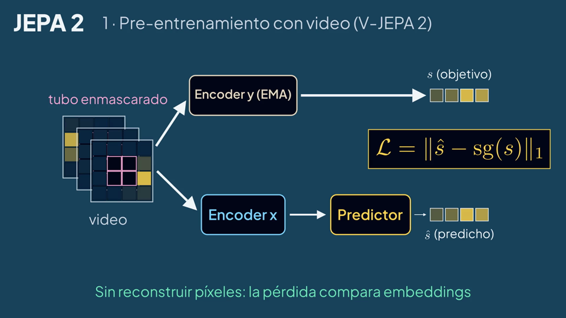
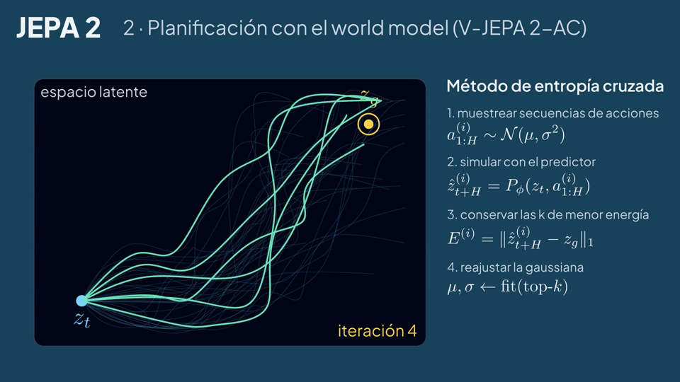
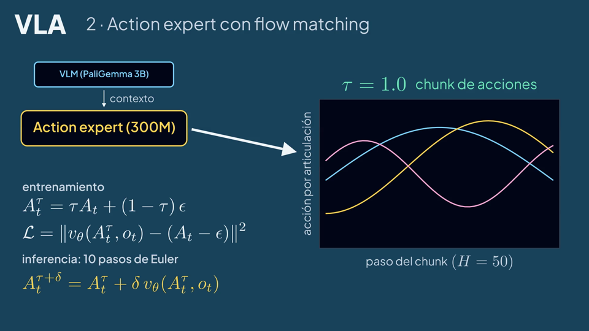
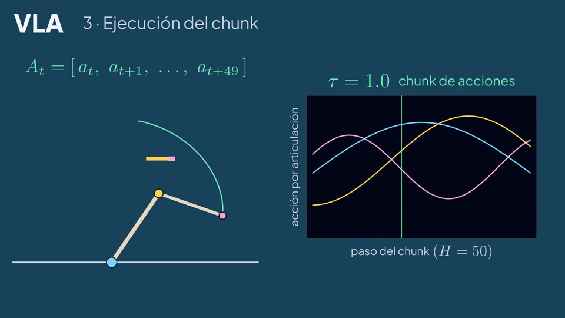
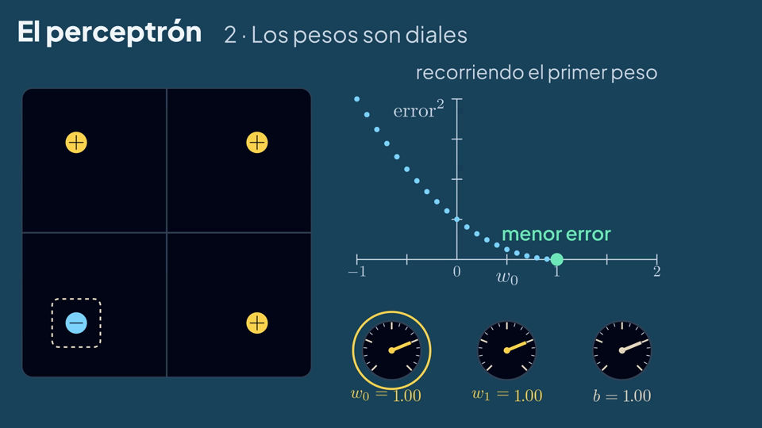
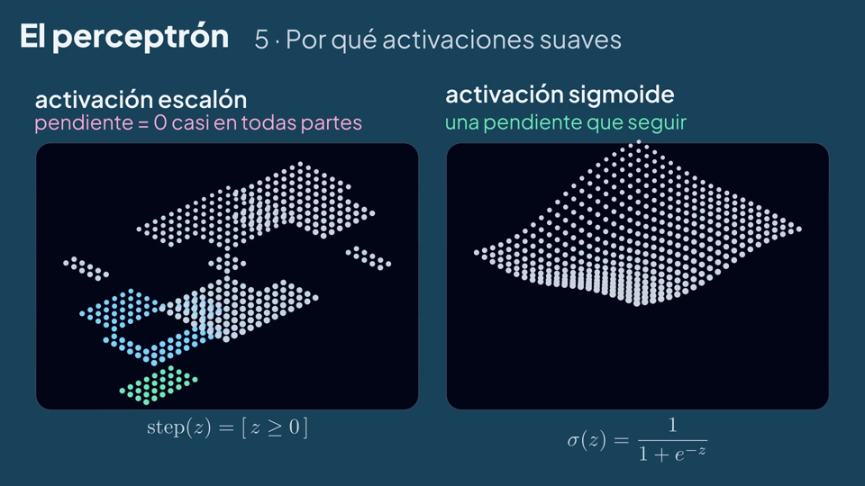
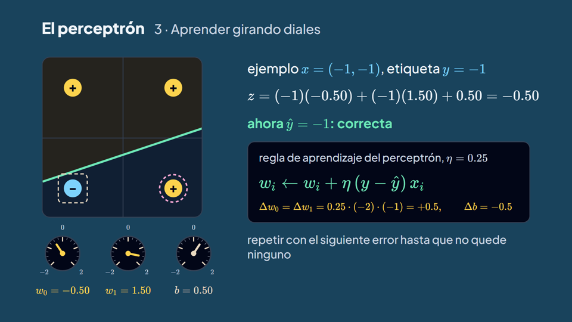
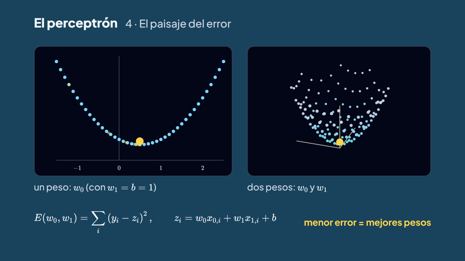
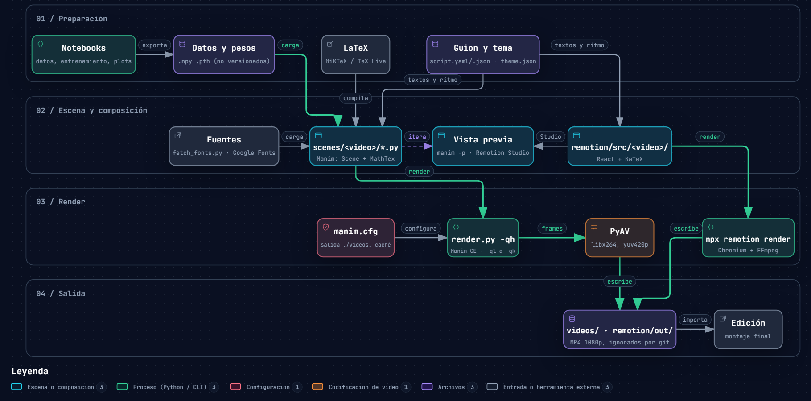

<p align="center">
  
</p>

<p align="center">
  <a href="https://www.manim.community/"></a>
  
  
  <a href="https://www.remotion.dev/"></a>
  
  <a href="LICENSE"></a>
</p>

<p align="center"><a href="README.md">English</a> · <b>Español</b></p>

Videos explicativos sobre modelos de IA, hechos con [Manim Community](https://www.manim.community/) (`scenes/`) y [Remotion](https://www.remotion.dev/) (`remotion/`). Cada video tiene un guion bilingüe (narración y texto en pantalla por sección) y se renderiza en inglés y en español con ecuaciones en LaTeX. El código original en manimgl del fork está en `legacy/`.

## Animaciones

| Video | Motor | Archivo | Escenas | Duración | Contenido |
|---|---|---|---|---|---|
| JEPA 2 | Manim | `scenes/jepa2/jepa2.py` | `JEPA2OverviewEN`, `JEPA2OverviewES` | 62 s (EN), 65 s (ES) | Predicción latente enmascarada (V-JEPA 2), planificación con CEM (V-JEPA 2-AC) |
| VLA | Manim | `scenes/vla/vla.py` | `VLAOverviewEN`, `VLAOverviewES` | 56 s (EN), 61 s (ES) | Entradas y tokens estilo π0, action expert con flow matching, ejecución del chunk |
| Perceptrón | Manim | `scenes/perceptron/perceptron.py` | `PerceptronOverviewEN`, `PerceptronOverviewES` | 107 s (EN), 114 s (ES) | Pesos como diales, curva y cuenco del error, XOR con dos neuronas ocultas escalón, paisajes con escalón y sigmoide, escala a transformers (redibuja `legacy/2025/perceptron`) |
| Perceptrón | Remotion | `remotion/src/perceptron/Perceptron.tsx` | `PerceptronEN`, `PerceptronES` | 86 s (EN), 86 s (ES) | Neurona de Rosenblatt, frontera de decisión, regla de aprendizaje con diales, paisaje del error, límite XOR |

<p align="center">
  
  
  
  
  
  
  
  
</p>

| Ecuación | Escena |
|---|---|
| $\mathcal{L} = \lVert \hat{s} - \mathrm{sg}(s) \rVert_1$ | JEPA 2, pérdida de predicción latente |
| $E^{(i)} = \lVert \hat{z}^{(i)}_{t+H} - z_g \rVert_1$ | JEPA 2, energía de la planificación con CEM |
| $\mathcal{L} = \lVert v_\theta(A^\tau_t, o_t) - (A_t - \epsilon) \rVert^2$ | VLA, pérdida de flow matching |
| $A^{\tau+\delta}_t = A^\tau_t + \delta\, v_\theta(A^\tau_t, o_t)$ | VLA, paso de integración de Euler |
| $w_i \leftarrow w_i + \eta\,(y - \hat{y})\,x_i$ | Perceptrón, regla de aprendizaje |

## Guion

Cada carpeta de video tiene un `script.yaml` que controla la escena: una entrada por sección con la narración y el texto en pantalla en inglés y en español.

```yaml
sections:
- id: masked_prediction            # mismo id que board.start(self, 'masked_prediction')
  narration:
    en: V-JEPA 2 is pretrained on more than a million hours of video...
    es: V-JEPA 2 se pre-entrena con más de un millón de horas de video...
  text:
    mask: {en: masked tube, es: tubo enmascarado}
```

| Paso | Comando o archivo |
|---|---|
| Editar narración o texto en pantalla | `scenes/<video>/script.yaml` |
| Renderizar un clip por sección | `python render.py -qh --save_sections scenes/jepa2/jepa2.py JEPA2OverviewES` |
| Exportar el guion legible con tiempos | `python scripts/export_scripts.py` → `scenes/<video>/script.<lang>.md` |
| Grabar la voz en off | Leer `script.<lang>.md`; cada clip dura al menos lo que su narración (150 palabras por minuto) |

`board.start()` abre una sección de manim y `board.hold()` alarga la última pausa de cada sección hasta cubrir su narración, así que editar el guion también ajusta el ritmo.

## Flujo de producción

<p align="center">
  
</p>

Versión interactiva en [`docs/diagrams/render-pipeline.es.html`](docs/diagrams/render-pipeline.es.html), generada con [archify](https://github.com/tt-a1i/archify) a partir de [`render-pipeline.es.workflow.json`](docs/diagrams/render-pipeline.es.workflow.json).

## Estructura del proyecto

```
scenes/                    escenas de Manim Community, una carpeta por video
├── theme.py               paleta, Plus Jakarta Sans, helpers label / eq / card
├── storyboard.py          carga script.yaml y marca el ritmo de las secciones (board.start / board.hold)
├── jepa2/
│   ├── jepa2.py           JEPA2OverviewEN, JEPA2OverviewES
│   ├── script.yaml        guion fuente: narración y texto en pantalla por sección (EN/ES)
│   └── script.en.md, script.es.md   guion legible con narración y tiempos de escena
├── vla/                   misma estructura (vla.py, script.yaml, script.*.md)
└── perceptron/            misma estructura (perceptron.py); redibuja las escenas de legacy/2025/perceptron
remotion/                  proyecto Remotion: composiciones, script.json por video (ver remotion/README.md)
assets/theme.json          paleta compartida por Manim y Remotion
assets/fonts/              fuentes de Manim, las descarga scripts/fetch_fonts.py (no versionado)
scripts/                   fetch_fonts.py, export_scripts.py (script.<lang>.md de cada video)
.claude/skills/            skills de Remotion para Claude Code (versiones fijadas en skills-lock.json)
CLAUDE.md                  notas de motores, skills y convenciones para Claude Code
docs/                      diagramas de flujo e imágenes del README (en/, es/)
legacy/                    código original en manimgl del fork (escenas, notebooks, helpers)
├── 2025/<video>/          backprop_1-3, deepseek, generalization, grokking, sora, ...
├── 2026/<video>/          jepa, jepa_2, resnets, rl, the_bitter_lesson, vla
│   └── data/              entradas y salidas locales de cada video (las rutas relativas apuntan aquí; no versionado)
├── config/                custom_config.yml (config portable de manimgl), welchlabs_original.yml (original en 8K)
├── custom/                helpers de manimgl
├── tools/                 render_legacy.py (lanzador de manimgl), stage_scenes.py, comandos de Sublime Text
└── requirements.txt, requirements-ml.txt   dependencias de manimgl y de los notebooks
manim.cfg                  config de Manim CE: carpetas de salida, caché
render.py                  lanzador del CLI de manim (arreglo de rutas en Windows, MiKTeX en el PATH)
```

## Instalación

```bash
git clone https://github.com/HiroForYou/ai-videos.git
cd ai-videos
python -m venv .venv
.venv\Scripts\activate              # Windows
source .venv/bin/activate           # macOS / Linux
pip install -r requirements.txt     # manim (Community), gráficos, notebooks
python scripts/fetch_fonts.py      # Plus Jakarta Sans para las escenas de Manim
cd remotion && npm i               # proyecto Remotion (Node.js 20.19+)
```

| Dependencia | Uso | Instalación |
|---|---|---|
| Python 3.11 | Ejecución | python.org |
| LaTeX | Ecuaciones con `MathTex` | MiKTeX en Windows (`winget install MiKTeX.MiKTeX`), MacTeX en macOS, `texlive-full` en Linux |
| Plus Jakarta Sans | Fuente del texto en Manim | `python scripts/fetch_fonts.py` → `assets/fonts/plus-jakarta-sans`, la registra `scenes/theme.py` |
| Node.js 20.19+ | Remotion | nodejs.org; Plus Jakarta Sans (Google Fonts) y KaTeX vienen de npm |
| FFmpeg | Codificación de video | No hace falta: PyAV viene con manim |

MiKTeX instala los paquetes de LaTeX que falten en el primer uso si se configura `initexmf --set-config-value [MPM]AutoInstall=1`.

## Render

Ejecutar desde la raíz del repo para que se cargue `manim.cfg`.

```bash
# 1. Borrador (480p15) y abrir el resultado
python render.py -ql -p scenes/vla/vla.py VLAOverviewES

# 2. Render final (1080p60), ambos idiomas
python render.py -qh scenes/vla/vla.py VLAOverviewES VLAOverviewEN

# 3. 4K
python render.py -qk scenes/jepa2/jepa2.py JEPA2OverviewES

# 4. Tamaño, cuadros por segundo y nombre propios
python render.py -r 2560,1440 --fps 30 -o jepa2_es_1440p scenes/jepa2/jepa2.py JEPA2OverviewES
```

`render.py` pasa todos los argumentos al CLI de `manim`. Es necesario cuando la ruta del repo contiene `(`, `)` o `+` (manim 0.22 compila la ruta del módulo como regex); en otras rutas `manim render <args>` funciona igual.

### Calidad

| Flag | Resolución | Cuadros por segundo | Uso habitual |
|---|---|---|---|
| `-ql` | 854x480 | 15 | Borradores |
| `-qm` | 1280x720 | 30 | Revisión |
| `-qh` | 1920x1080 | 60 | Render final |
| `-qp` | 2560x1440 | 60 | Entrega en 1440p |
| `-qk` | 3840x2160 | 60 | Entrega en 4K |
| `-r W,H` | Cualquiera | - | Tamaño propio |
| `--fps N` | - | Cualquiera | Cuadros por segundo propios |

### Salida

| Flag | Resultado |
|---|---|
| (por defecto) | `videos/<archivo>/<calidad>/<Escena>.mp4`, por ejemplo `videos/vla/1080p60/VLAOverviewES.mp4` |
| `-p` | Abre el archivo al terminar |
| `-o NOMBRE` | Nombre del archivo de salida |
| `--format gif\|webm\|mov\|png` | Contenedor o salida en imagen |
| `-t` | Fondo transparente (`.mov` o `.webm`) |
| `-s` | Guarda solo el último cuadro como PNG |
| `-a` | Renderiza todas las escenas del archivo |
| `-n 3,6` | Renderiza solo las animaciones 3 a 6 |
| `--media_dir DIR` | Carpeta para cachés de LaTeX, texto y clips parciales (por defecto `./.cache/manim`) |

### Configuración (`manim.cfg`)

| Clave | Valor | Efecto |
|---|---|---|
| `media_dir` | `./.cache/manim` | Cachés de LaTeX y texto |
| `video_dir` | `./videos/{module_name}/{quality}` | Videos finales |
| `images_dir` | `./videos/images/{module_name}` | Salida PNG (`-s`) |
| `partial_movie_dir` | `{media_dir}/partial_movie_files/...` | Clips por animación |

### Tema (`assets/theme.json`)

Colores de [cristhianwiki.com](https://www.cristhianwiki.com/) (tema oscuro 'original' de `palettes.js`). Una sola paleta para los dos motores: `scenes/theme.py` la carga y fija el fondo de Manim; `remotion/src/theme.ts` la importa.

| Token | Hex | Uso |
|---|---|---|
| `BG` | `#191919` | Fondo |
| `PANEL` / `PANEL_STROKE` | `#232323` / `#303030` | Tarjetas, gráficos, bordes |
| `PRIMARY` | `#6d83f2` | Acento de marca |
| `TEXT` / `MUTED` | `#f8f8f8` / `#b3b3b3` | Texto |
| `SKY`, `SAND` | `#6a98f0`, `#c7d0ff` | Azules de la web (primaryLight, borde del tema claro) |
| `AMBER`, `PINK`, `EMERALD` | `#f2c36d`, `#f28fb0`, `#6fd8b4` | Acentos derivados que complementan el azul (contraste ≥ 6.2:1 sobre el fondo) |

Las escenas usan `label()` (Plus Jakarta Sans, pesos `NORMAL` a `ULTRABOLD`), `eq()` (`MathTex`) y `card()`.

## Remotion

Composiciones React en `remotion/`, con la misma paleta y tipografía (Plus Jakarta Sans) que las escenas de Manim y ecuaciones con KaTeX. Detalle en [`remotion/README.md`](remotion/README.md).

| Tarea | Comando (desde `remotion/`) |
|---|---|
| Vista previa en Studio | `npm run dev` |
| Render | `npx remotion render PerceptronES out/perceptron-es.mp4` |
| Cuadros como PNG | `npx remotion render PerceptronES out/frames --frames=0,300 --image-format=png` |
| Tipos y lint | `npm run lint` |

Las skills oficiales de Remotion están instaladas para Claude Code en `.claude/skills/` (`remotion-best-practices` dirige a create, markup, render, studio, captions, docs y upgrade). Se actualizan con `npx skills update -p`.

## Código heredado

`legacy/` conserva las escenas y notebooks originales en manimgl. Todas las rutas de entrada y salida son relativas y apuntan a la carpeta `data/` de su video; el encabezado de cada script lista las rutas que usa. Los archivos no están en el repo.

| Tipo de archivo | Rutas relativas a | Ejemplo |
|---|---|---|
| Scripts `.py` | Raíz del repo (se ejecutan desde ahí) | `legacy/2026/jepa_2/data/graphics/p14_to_manim` |
| Notebooks `.ipynb` | Carpeta del notebook (directorio de trabajo de Jupyter) | `data/graphics/p14_to_manim` |

```bash
pip install -r legacy/requirements.txt
python legacy/tools/render_legacy.py legacy/2025/perceptron/p45_51.py P45_48v2 -w
```

`legacy/tools/render_legacy.py` pasa todos los argumentos a `manimgl`, agrega `legacy/config/custom_config.yml` y corrige dos problemas de manimgl 1.7.2 con MiKTeX en Windows (el flag `-no-pdf` y las rutas temporales cortas 8.3).

## Archivos no versionados

| Patrón | Motivo |
|---|---|
| `videos/`, `.cache/manim/`, `*.mp4`, `*.mov`, `*.webm`, `*.gif`, ... | Salidas de render y cachés |
| `*.pth`, `*.pt`, `*.ckpt`, `*.safetensors` | Pesos de modelos; se regeneran con los notebooks |
| `*.npy`, `*.npz`, `*.p`, `*.pkl`, `*.json` | Arrays y datos generados (excepto fuentes de diagramas, config y guiones de Remotion, `skills-lock.json`) |
| `assets/fonts/` | Fuentes descargadas (`python scripts/fetch_fonts.py`) |
| `remotion/node_modules/`, `remotion/out/` | Paquetes npm y renders de Remotion |
| `archive/`, `old/`, `old_notebooks/` | Código en desuso, solo en local |
| `legacy/*/*/data/` | Entradas y salidas locales de los scripts heredados |
| `runs/`, `raw_data/`, `wandb/` | Corridas de entrenamiento y datasets |

## Ramas

| Rama | Rol |
|---|---|
| `dev` | Rama por defecto, desarrollo activo |
| `master` | Snapshot del fork original; sin mantenimiento |

## Licencia y origen

[MIT](LICENSE). Fork de [WelchLabs/videos](https://github.com/WelchLabs/videos); `LICENSE` conserva el aviso de copyright original, como exige la licencia MIT. Plus Jakarta Sans se distribuye bajo la SIL Open Font License.
