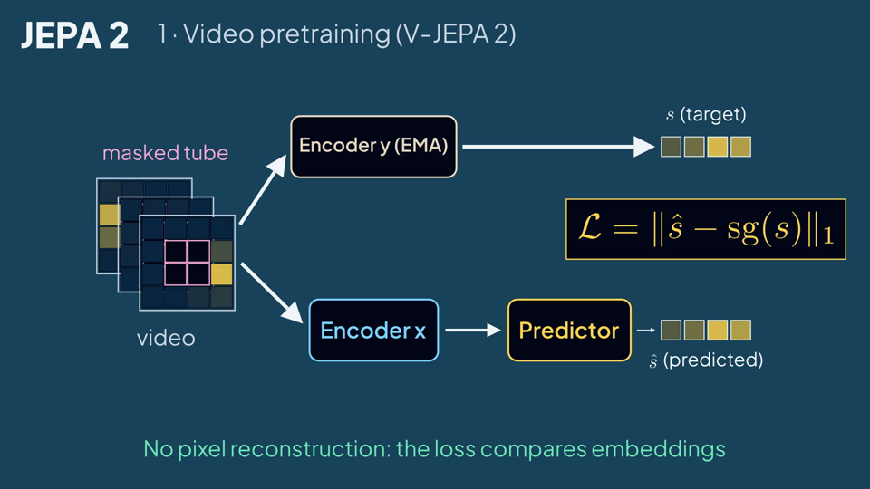
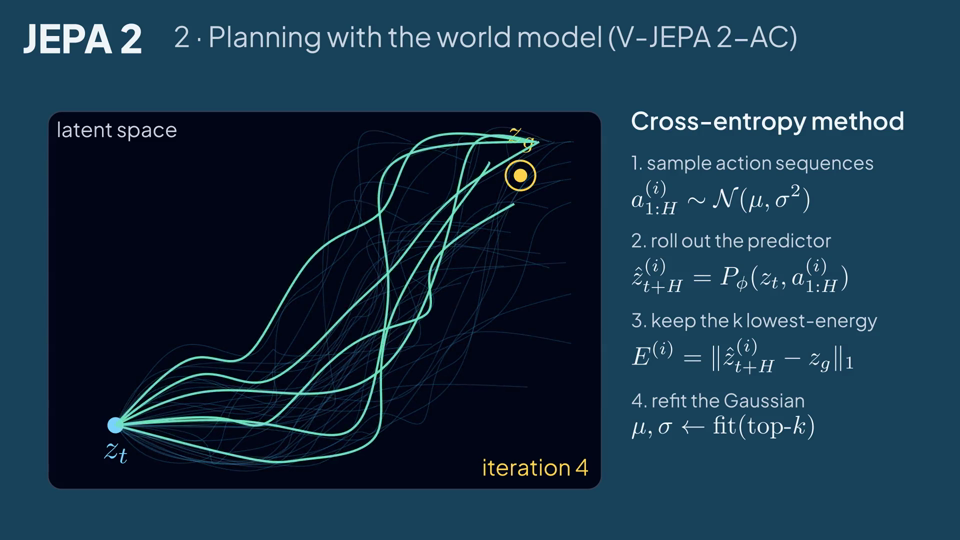
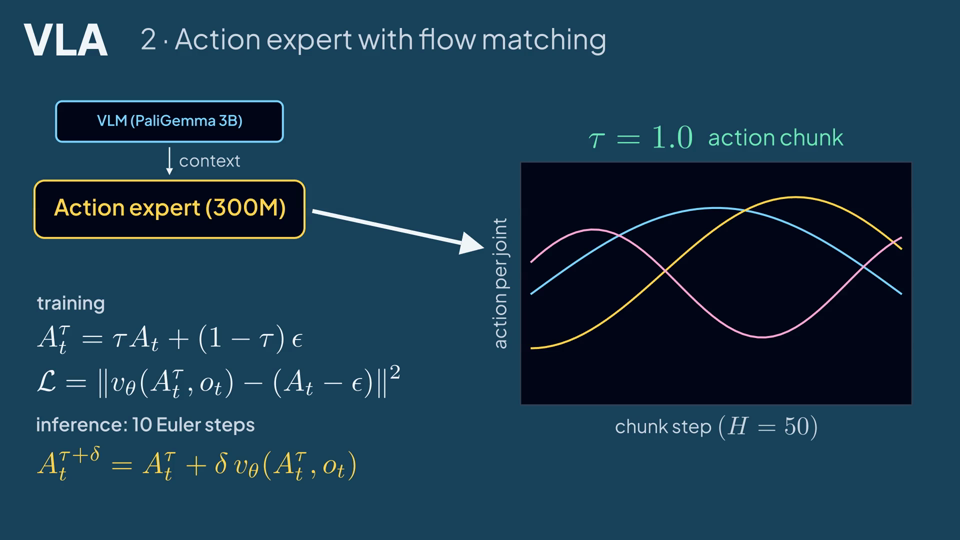
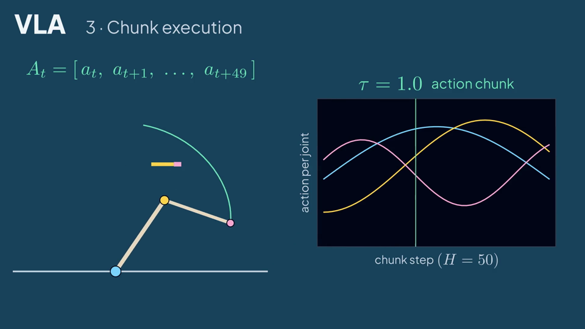
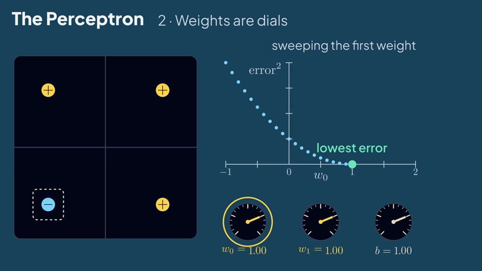
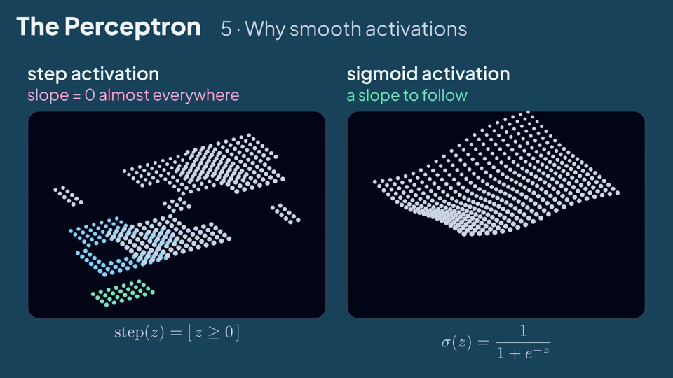
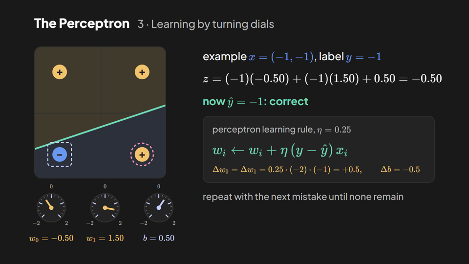
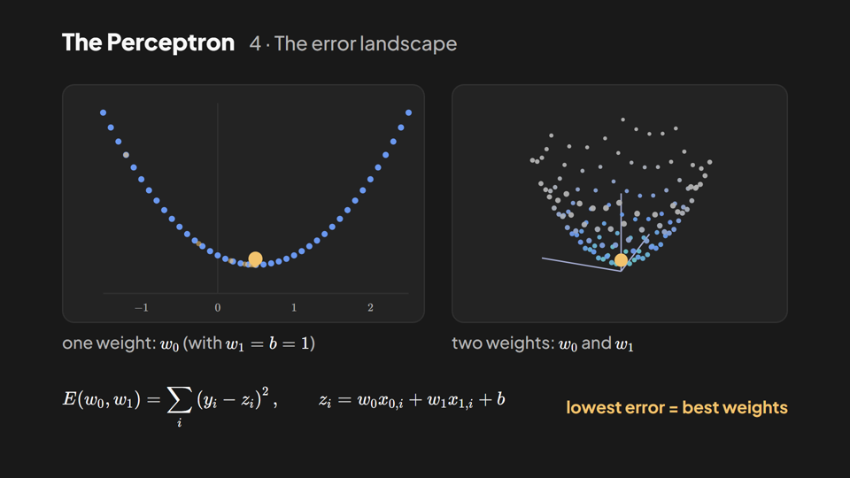
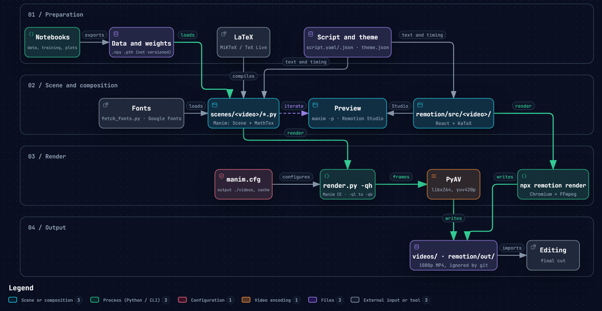

<p align="center">
  
</p>

<p align="center">
  <a href="https://www.manim.community/"></a>
  
  
  <a href="https://www.remotion.dev/"></a>
  
  <a href="LICENSE"></a>
</p>

<p align="center"><b>English</b> · <a href="README.es.md">Español</a></p>

Explainer videos about AI models, built with [Manim Community](https://www.manim.community/) (`scenes/`) and [Remotion](https://www.remotion.dev/) (`remotion/`). Each video has a bilingual script (narration and on-screen text per section) and renders in English and Spanish with LaTeX equations. The original manimgl code of the fork lives in `legacy/`.

## Animations

| Video | Engine | File | Scenes | Length | Content |
|---|---|---|---|---|---|
| JEPA 2 | Manim | `scenes/jepa2/jepa2.py` | `JEPA2OverviewEN`, `JEPA2OverviewES` | 62 s (EN), 65 s (ES) | V-JEPA 2 masked latent prediction, V-JEPA 2-AC planning with CEM |
| VLA | Manim | `scenes/vla/vla.py` | `VLAOverviewEN`, `VLAOverviewES` | 56 s (EN), 61 s (ES) | π0-style inputs and tokens, flow-matching action expert, chunk execution |
| Perceptron | Manim | `scenes/perceptron/perceptron.py` | `PerceptronOverviewEN`, `PerceptronOverviewES` | 120 s (ES) | Weights as dials; dials sweep w0 and w1 while the error bowl appears; gradient descent on w0, w1 and b; XOR with two hidden step neurons; step vs sigmoid landscapes with an SGD path; zoom out to 12 transformer blocks (redraws all four `legacy/2025/perceptron` scripts) |
| Backpropagation, part 1 | Manim | `scenes/backprop_1/backprop_1.py` | `Backprop1OverviewEN`, `Backprop1OverviewES` | 165 s (ES) | Next-token probabilities of Llama 3.2 1B; loss -log p; loss surface over two last-layer weights; gradient arrows and descent; random-direction slices; a landscape that changes while training; hidden valley; line fit and its loss surface (redraws `legacy/2025/backprop_1`) |
| Perceptron | Remotion | `remotion/src/perceptron/Perceptron.tsx` | `PerceptronEN`, `PerceptronES` | 86 s (EN), 86 s (ES) | Rosenblatt's neuron, decision boundary, learning rule with dials, error landscape, XOR limit |

<p align="center">
  
  
  
  
  
  
  
  
</p>

| Equation | Scene |
|---|---|
| $\mathcal{L} = \lVert \hat{s} - \mathrm{sg}(s) \rVert_1$ | JEPA 2, latent prediction loss |
| $E^{(i)} = \lVert \hat{z}^{(i)}_{t+H} - z_g \rVert_1$ | JEPA 2, CEM planning energy |
| $\mathcal{L} = \lVert v_\theta(A^\tau_t, o_t) - (A_t - \epsilon) \rVert^2$ | VLA, flow-matching loss |
| $A^{\tau+\delta}_t = A^\tau_t + \delta\, v_\theta(A^\tau_t, o_t)$ | VLA, Euler integration step |
| $w_i \leftarrow w_i + \eta\,(y - \hat{y})\,x_i$ | Perceptron, learning rule |
| $E(w_0, w_1, b) = \sum_{i=1}^{4} (y_i - \hat{y}_i)^2$ | Perceptron, error landscape |

## Script

Each video folder has a `script.yaml` that drives the scene: one entry per section with the narration and the on-screen text in English and Spanish.

```yaml
sections:
- id: masked_prediction            # same id as board.start(self, 'masked_prediction')
  narration:
    en: V-JEPA 2 is pretrained on more than a million hours of video...
    es: V-JEPA 2 se pre-entrena con más de un millón de horas de video...
  text:
    mask: {en: masked tube, es: tubo enmascarado}
```

| Step | Command or file |
|---|---|
| Edit narration or on-screen text | `scenes/<video>/script.yaml` |
| Render with one clip per section | `python render.py -qh --save_sections scenes/jepa2/jepa2.py JEPA2OverviewEN` |
| Export the readable script with timings | `python scripts/export_scripts.py` → `scenes/<video>/script.<lang>.md` |
| Record the voice-over | Read `script.<lang>.md`; each section clip lasts at least its narration (150 words per minute) |

`board.start()` opens a manim section and `board.hold()` extends the last pause of each section until it covers its narration, so text edits in the script also adjust the timing.

## Production workflow

<p align="center">
  
</p>

Interactive version: [`docs/diagrams/render-pipeline.en.html`](docs/diagrams/render-pipeline.en.html), generated with [archify](https://github.com/tt-a1i/archify) from [`render-pipeline.en.workflow.json`](docs/diagrams/render-pipeline.en.workflow.json).

## Project structure

```
scenes/                    Manim Community scenes, one folder per video
├── theme.py               palette, Plus Jakarta Sans, label / eq / card helpers
├── storyboard.py          loads script.yaml, paces sections (board.start / board.hold)
├── jepa2/
│   ├── jepa2.py           JEPA2OverviewEN, JEPA2OverviewES
│   ├── script.yaml        script source: narration and on-screen text per section (EN/ES)
│   └── script.en.md, script.es.md   readable script with narration and scene timing
├── vla/                   same layout (vla.py, script.yaml, script.*.md)
├── perceptron/            same layout (perceptron.py); redraws the legacy/2025/perceptron scenes
└── backprop_1/            same layout (backprop_1.py); redraws the legacy/2025/backprop_1 scenes
remotion/                  Remotion project: compositions, script.json per video (see remotion/README.md)
assets/theme.json          shared palette for Manim and Remotion
assets/fonts/              Manim fonts, downloaded by scripts/fetch_fonts.py (not versioned)
scripts/                   fetch_fonts.py, export_scripts.py (script.<lang>.md for every video)
.claude/skills/            Remotion agent skills for Claude Code (pinned in skills-lock.json)
CLAUDE.md                  engine, skill and convention notes for Claude Code
docs/                      workflow diagrams and README images (en/, es/)
legacy/                    original manimgl code of the fork (scenes, notebooks, helpers)
├── 2025/<video>/          backprop_1-3, deepseek, generalization, grokking, sora, ...
├── 2026/<video>/          jepa, jepa_2, resnets, rl, the_bitter_lesson, vla
│   └── data/              local inputs and outputs of each video (relative paths point here; not versioned)
├── config/                custom_config.yml (portable manimgl config), welchlabs_original.yml (original 8K)
├── custom/                manimgl helpers
├── tools/                 render_legacy.py (manimgl launcher), stage_scenes.py, Sublime Text commands
└── requirements.txt, requirements-ml.txt   manimgl and notebook dependencies
manim.cfg                  Manim CE config: output folders, cache
render.py                  manim CLI launcher (path fix for Windows, MiKTeX on PATH)
```

## Setup

```bash
git clone https://github.com/HiroForYou/ai-videos.git
cd ai-videos
python -m venv .venv
.venv\Scripts\activate              # Windows
source .venv/bin/activate           # macOS / Linux
pip install -r requirements.txt     # manim (Community), plotting, notebooks, nbstripout
nbstripout --install               # strip notebook outputs on commit (they stay on disk)
python scripts/fetch_fonts.py      # Plus Jakarta Sans for the Manim scenes
cd remotion && npm i               # Remotion project (Node.js 20.19+)
```

| Dependency | Use | Install |
|---|---|---|
| Python 3.11 | Runtime | python.org |
| LaTeX | `MathTex` equations | MiKTeX on Windows (`winget install MiKTeX.MiKTeX`), MacTeX on macOS, `texlive-full` on Linux |
| Plus Jakarta Sans | Manim text font | `python scripts/fetch_fonts.py` → `assets/fonts/plus-jakarta-sans`, registered by `scenes/theme.py` |
| Node.js 20.19+ | Remotion | nodejs.org; Plus Jakarta Sans (Google Fonts) and KaTeX come from npm |
| FFmpeg | Video encoding | Not needed: PyAV ships with manim |

MiKTeX installs missing LaTeX packages on first use when `initexmf --set-config-value [MPM]AutoInstall=1` is set.

## Rendering

Run from the repo root so `manim.cfg` is picked up.

```bash
# 1. Draft (480p15) and open the result
python render.py -ql -p scenes/vla/vla.py VLAOverviewEN

# 2. Final render (1080p60), both languages
python render.py -qh scenes/vla/vla.py VLAOverviewEN VLAOverviewES

# 3. 4K
python render.py -qk scenes/jepa2/jepa2.py JEPA2OverviewEN

# 4. Custom size, frame rate and file name
python render.py -r 2560,1440 --fps 30 -o jepa2_es_1440p scenes/jepa2/jepa2.py JEPA2OverviewES
```

`render.py` forwards every argument to the `manim` CLI. It is required when the repo path contains `(`, `)` or `+` (manim 0.22 compiles the module path as a regex); elsewhere `manim render <args>` works the same.

### Quality

| Flag | Resolution | Frame rate | Typical use |
|---|---|---|---|
| `-ql` | 854x480 | 15 | Drafts |
| `-qm` | 1280x720 | 30 | Reviews |
| `-qh` | 1920x1080 | 60 | Final render |
| `-qp` | 2560x1440 | 60 | 1440p delivery |
| `-qk` | 3840x2160 | 60 | 4K delivery |
| `-r W,H` | Any | - | Custom size |
| `--fps N` | - | Any | Custom frame rate |

### Output

| Flag | Result |
|---|---|
| (default) | `videos/<file>/<quality>/<Scene>.mp4`, e.g. `videos/vla/1080p60/VLAOverviewEN.mp4` |
| `-p` | Opens the file when done |
| `-o NAME` | Output file name |
| `--format gif\|webm\|mov\|png` | Container or image output |
| `-t` | Transparent background (`.mov` or `.webm`) |
| `-s` | Saves only the last frame as PNG |
| `-a` | Renders every scene in the file |
| `-n 3,6` | Renders animations 3 to 6 only |
| `--media_dir DIR` | Folder for LaTeX, text caches and partial movies (default `./.cache/manim`) |

### Configuration (`manim.cfg`)

| Key | Value | Effect |
|---|---|---|
| `media_dir` | `./.cache/manim` | LaTeX and text caches |
| `video_dir` | `./videos/{module_name}/{quality}` | Final videos |
| `images_dir` | `./videos/images/{module_name}` | PNG output (`-s`) |
| `partial_movie_dir` | `{media_dir}/partial_movie_files/...` | Per-animation clips |

### Theme (`assets/theme.json`)

Colors of [cristhianwiki.com](https://www.cristhianwiki.com/) ('original' dark theme in `palettes.js`). One palette for both engines: `scenes/theme.py` loads it and sets the Manim background; `remotion/src/theme.ts` imports it.

| Token | Hex | Use |
|---|---|---|
| `BG` | `#191919` | Background |
| `PANEL` / `PANEL_STROKE` | `#232323` / `#303030` | Cards, plots, borders |
| `PRIMARY` | `#6d83f2` | Brand accent |
| `TEXT` / `MUTED` | `#f8f8f8` / `#b3b3b3` | Text |
| `SKY`, `SAND` | `#6a98f0`, `#c7d0ff` | Site blues (primaryLight, light-theme border) |
| `AMBER`, `PINK`, `EMERALD` | `#f2c36d`, `#f28fb0`, `#6fd8b4` | Accents derived to complement the blue (contrast ≥ 6.2:1 on the background) |

Scenes use `label()` (Plus Jakarta Sans, weights `NORMAL` to `ULTRABOLD`), `eq()` (`MathTex`) and `card()`.

## Remotion

React compositions in `remotion/`, with the same palette and typeface (Plus Jakarta Sans) as the Manim scenes and KaTeX equations. Details in [`remotion/README.md`](remotion/README.md).

| Task | Command (from `remotion/`) |
|---|---|
| Preview in Studio | `npm run dev` |
| Render | `npx remotion render PerceptronEN out/perceptron-en.mp4` |
| Frames as PNG | `npx remotion render PerceptronES out/frames --frames=0,300 --image-format=png` |
| Type check and lint | `npm run lint` |

The official Remotion agent skills are installed for Claude Code in `.claude/skills/` (`remotion-best-practices` routes to create, markup, render, studio, captions, docs and upgrade). Update them with `npx skills update -p`.

## Legacy code

`legacy/` keeps the original manimgl scenes and notebooks. Every input and output path is relative and points to the `data/` folder of its video; each script header lists the paths it uses. The files themselves are not in the repo.

| File type | Paths relative to | Example |
|---|---|---|
| `.py` scripts | Repo root (run from there) | `legacy/2026/jepa_2/data/graphics/p14_to_manim` |
| `.ipynb` notebooks | Notebook folder (Jupyter working directory) | `data/graphics/p14_to_manim` |

```bash
pip install -r legacy/requirements.txt
python legacy/tools/render_legacy.py legacy/2025/perceptron/p45_51.py P45_48v2 -w
```

`legacy/tools/render_legacy.py` forwards every argument to `manimgl`, adds `legacy/config/custom_config.yml` and fixes two MiKTeX issues of manimgl 1.7.2 on Windows (the `-no-pdf` flag and 8.3 short temp paths).

### Input availability

Most legacy scenes load SVGs exported from Illustrator, stock footage and training runs that lived in the original author's Dropbox. Those files were never published, neither in this repo nor in [WelchLabs/videos](https://github.com/WelchLabs/videos). Each scene falls into one of four groups (static audit of every `.py` and `.ipynb` under `legacy/`):

| Group | Meaning |
|---|---|
| Self-contained | Renders after a clone; uses only code or files tracked in `legacy/` |
| Upstream | Needs files that exist in `upstream/master` but are ignored in `dev` (`*.pth`, `*.p`, `*.json`, `data/`) |
| Regenerable | Its `data/` inputs are produced by a notebook of the same video |
| External | Needs author files that no script produces (SVGs, stock media, private runs, the `helpers` module) |

| Video | Self-contained | Upstream | Regenerable (notebook that produces the inputs) | External |
|---|---|---|---|---|
| `2025/backprop_1` | `p21*.py`, `p29c`, `p48b`, `p53` | - | `p24_28`, `p33_35*`, `p39_48`, `p48c`, `p50_51`, `opening_rewrite*`, `thumbnail_hackin_1` (`generate_inputs.py`; Llama 3.2 1B from Hugging Face) | `p6_8`, `poster_hackin_2` |
| `2025/backprop_2` | `p_27`, `network_pranav_pr_1` | - | `p32_40`, `p40_44`, `p44_46`, `p48_49` (`European Cities 1D/2D [Part 1].ipynb`); `p12_quick_zoom`, `p51`, `llama_learning_animation_9-11` (`Llama Exporting 4.ipynb`, Llama weights) | `p22_24`, `p26_28`, `p50`, other `llama_learning_animation_*` (runs `may_31_1`, `jun_*`) |
| `2025/backprop_3` | `equations` | `p7`, `p12`, `p23_28`, `p63`, `refactor_sketch_*` (`models/*.pth`, `models/*.p`) | `p64` (`Simple Loss While Training Plot.ipynb`) | `p3_6`, `p17_and_21`, `p18_21`, `p35_41`, `p46_53`, `p61_62`, `plane_folding_sketch_*` |
| `2025/deepseek` | - | - | - | All scenes (SVGs, attention exports from `linux_workdir`) |
| `2025/generalization` | `p18`, `p18_sw`, `p58` | - | Polynomial fits of `p65_68` (`Final Video Polynomial Examples.ipynb`; its SVGs stay external) | `p8_15`, `p20`, `p33`, `p46_56` |
| `2025/grokking` | - | - | `p59_65`, `book_surfaces_1` (`notebooks/training_*.ipynb` create a new run `grok_<timestamp>`; point `data_dir` to it) | SVGs of `p25_26`, `p27_31`, `p33_38`, `p41_58` |
| `2025/mech_interp_partial` | - | - | - | `p25_36_book` (`helpers` module) |
| `2025/perceptron` | `p45_51`, `p45_51_book_graphics`, `p66_67` | - | - | `p69_72` (`helpers` module) |
| `2025/sora` | `p20_21`, `p24` | - | `p40_51`, `p53_59`, `p66_68`, part of `p78_85` (`Toy Sampling Animations *`, `Conditioning and Guidance *`; they save to `data/sora/`, the scenes read `data/hackin/`) | `p39` |
| `2025/subliminal_learning` | - | - | - | `p27_48`, `p27_40_pranav` |
| `2026/jepa` | `p14_18` | - | - | All other scenes (SVGs, image pairs, clips) |
| `2026/jepa_2` | `p61_vectors`, `p67_vectors` | - | Real Push-T frames and CEM data of `P67_75`, `P84_85` (`p67`, `p69_73`, `p75bb`; `stable-worldmodel`, checkpoint `quentinll/lewm-pusht`, 13 GB dataset) | SVGs, stock video, frames decoded by the world model (author's decoder weights) |
| `2026/resnets` | `P30` | `p32` (`data/loss_2d_1.npy`) | `p25_35`, `p33_network`, `p34_*`, `p41_45_networks`, `p47_48_*`, `p54_60`, `p63_69`, `p70_73`, `P35_gradient_field` (`P25_37c/d`, `general_activation_saving_1`, `P33_35a`, `p63_cache_activations`; ImageNet, manual download) | `p13_30`, `alexnet_assets_gen` |
| `2026/rl` | `games/pong/*`, `games/breakout/*` (train with `gymnasium` and `ale-py`) | - | `rl_hacking_1` (`slides_rl_1*.ipynb`) | `book_figure_28` |
| `2026/the_bitter_lesson` | `p10_1`, `integration_problems`, `alpha_go_cnn_hacking`, `go_games_grid_3d` | `p4`, `p4_1` (`phone_dag_v2.json`, `phone_dag_claude_v2.json`) | - | `p5*`, `p29_41`, `gameplay_animations`, `go_board_hacking_1` |
| `2026/vla` | `p35` | - | `p50` (`p50_cat_diffusion.ipynb`, diffusers) | `p1_6`, `p31_61_1`, `p51`, `p52`, `poster_1` |

Book, merch and thumbnail variants (`*_book`, `*_merch`, `thumbnail_*`) share the group of their base scene.

Upstream files keep the original layout (`_2025/...`). Extract them into `legacy/<year>/`:

```bash
git fetch upstream
git archive upstream/master _2025/backprop_3/models | tar -x --strip-components=1 -C legacy/2025
git archive upstream/master _2026/the_bitter_lesson/phone_dag_v2.json _2026/the_bitter_lesson/phone_dag_claude_v2.json | tar -x --strip-components=1 -C legacy/2026
git archive upstream/master _2026/resnets/data/loss_2d_1.npy | tar -x --strip-components=1 -C legacy/2026
```

## Untracked files

| Pattern | Reason |
|---|---|
| `videos/`, `.cache/manim/`, `*.mp4`, `*.mov`, `*.webm`, `*.gif`, ... | Render outputs and caches |
| `*.pth`, `*.pt`, `*.ckpt`, `*.safetensors` | Model weights; regenerate with the notebooks |
| `*.npy`, `*.npz`, `*.p`, `*.pkl`, `*.json` | Arrays and generated data (except diagram sources, Remotion config and scripts, `skills-lock.json`) |
| `assets/fonts/` | Downloaded fonts (`python scripts/fetch_fonts.py`) |
| `remotion/node_modules/`, `remotion/out/` | npm packages and Remotion renders |
| `archive/`, `old/`, `old_notebooks/` | Deprecated code, kept locally only |
| `legacy/*/*/data/` | Local inputs and outputs of the legacy scripts |
| `runs/`, `raw_data/`, `wandb/` | Training runs and datasets |
| Notebook outputs | Removed on commit by the `nbstripout` git filter; the `.ipynb` files on disk keep them |

## License and origin

[MIT](LICENSE). Forked from [WelchLabs/videos](https://github.com/WelchLabs/videos); the original copyright notice is kept in `LICENSE` as the MIT license requires. Plus Jakarta Sans is distributed under the SIL Open Font License.
